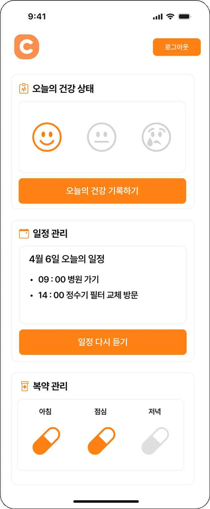
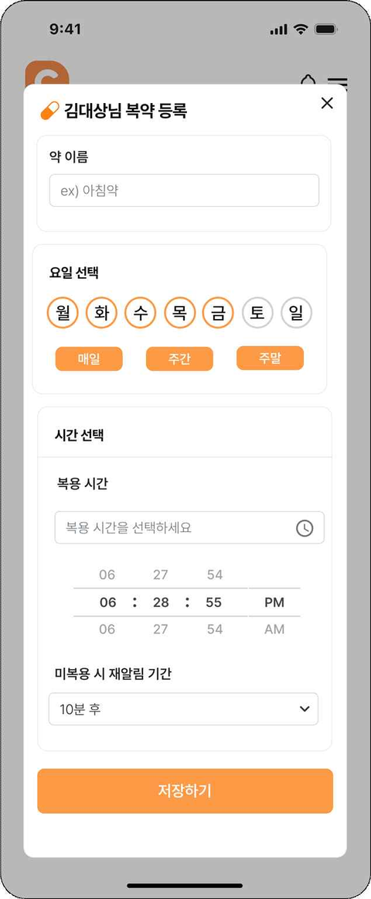
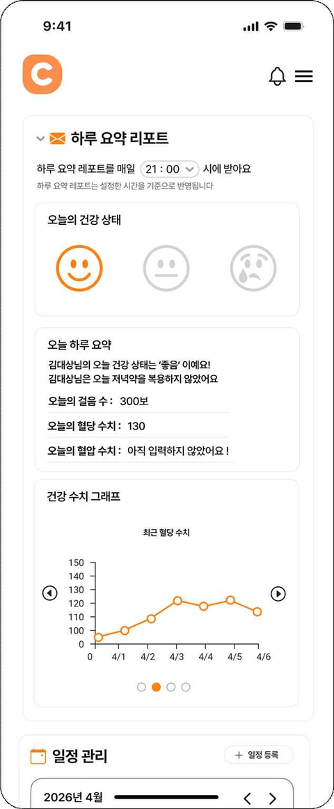
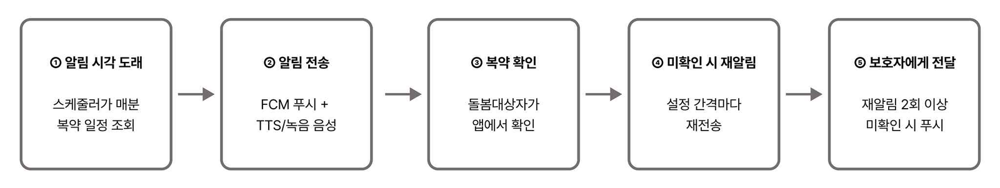
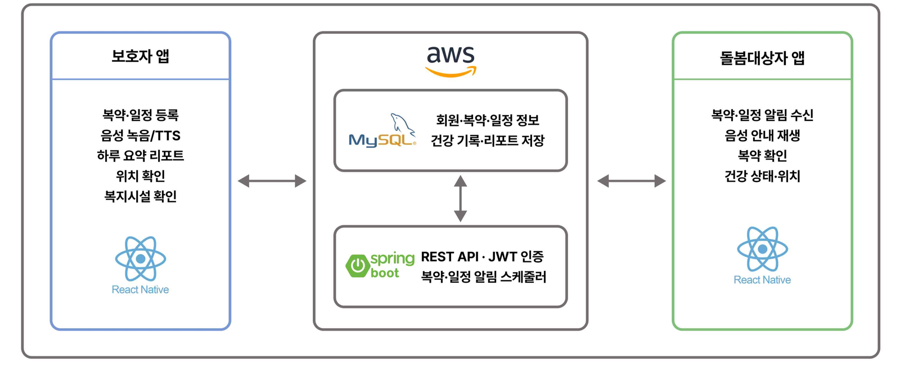

<div align="center">


# Caring

### 멀리 있는 보호자와 혼자 지내는 어르신을 잇는 복약·일정 케어 앱

[](#다운로드)
[](#기술-스택)
[](#기술-스택)

**[⬇ 최신 버전 다운로드 (GitHub Release)](https://github.com/Caring-App/Caring-FrontEnd/releases/latest)** · **[▶ 시연 영상 보기](https://m.site.naver.com/2jvlP)**

[주요 기능](#주요-기능) · [다운로드](#다운로드) · [시스템 구성](#시스템-구성) · [기술 스택](#기술-스택) · [실행 방법](#실행-방법) · [팀원](#팀원)





<sub>돌봄대상자 홈 · 보호자 복약 등록 · 보호자 하루 요약 리포트</sub>

</div>

<br />

Caring은 보호자와 돌봄대상자(어르신)가 함께 쓰는 Android 앱입니다.
보호자가 복약과 일정을 등록하면 정해진 시각에 어르신 휴대폰으로 알림과 음성 안내가 갑니다.
어르신이 복약을 확인하지 않으면 다시 알리고, 그래도 확인이 없으면 보호자에게 알려 줍니다.

이 저장소는 Caring의 **프론트엔드(React Native 앱)** 입니다. 서버는 [Caring-BackEnd](https://github.com/Caring-App/Caring-BackEnd)에 있습니다.

## 기획 배경

혼자 지내는 어르신이 늘면서, 보호자가 곁에 없을 때 약 드실 시간이나 병원 일정을 놓치는 일이 생깁니다.
보호자는 멀리서 어르신 상태를 확인하기 어렵고, 어르신은 혼자 복약과 일정을 챙겨야 합니다.
Caring은 이 **돌봄 공백**을 줄이기 위해, 멀리 있어도 어르신의 하루를 확인하고 필요할 때 바로 개입할 수 있게 만들었습니다.

## 주요 기능

하나의 앱에서 로그인한 역할에 따라 **보호자 화면**과 **돌봄대상자 화면**으로 나뉩니다.
두 계정은 보호자의 **고유 연동 코드**로 1:1 연결됩니다.

### 보호자

- **복약 등록:** 약 이름, 복용 요일(매일·주중·주말)과 시간, 재알림 간격 설정
- **일정 등록:** 병원 방문 같은 일정을 장소·시간과 함께 등록
- **알림 음성 선택:** TTS 합성 음성 또는 보호자가 직접 녹음한 목소리
- **위치 확인:** 돌봄대상자의 현재 위치를 지도에서 확인
- **하루 요약 리포트:** 기분, 걸음 수, 건강 기록, 복약률을 Gemini가 한 문단으로 요약
- **건강 기록 그래프:** 혈당·혈압 등 질환별 최근 기록을 그래프로 확인
- **주변 복지시설:** 돌봄대상자 주소 기준 반경 3km 안의 사회복지시설을 가까운 순으로 안내
- **돌봄대상자 관리:** 어르신 화면의 글자 크기와 음성 속도를 원격으로 조절

### 돌봄대상자

- 복약·일정 알림을 **음성으로 안내**받기 (앱이 꺼져 있어도 재생)
- **버튼 하나로 복약 확인**
- 오늘의 기분과 건강 상태(혈당·혈압 등) 기록
- 오늘 일정 다시 듣기

### 복약 알림 흐름



서버 스케줄러가 매분 알림 시각을 확인해 FCM 푸시와 음성 파일 주소를 보내고, 앱은 이를 받아 바로 음성을 재생합니다.
돌봄대상자가 확인하지 않으면 설정한 간격마다 두 번 더 알리고, 그래도 확인이 없으면 보호자에게 푸시를 보냅니다.
예를 들어 재알림 간격이 5분이면 5분·10분 뒤 재알림, 15분 뒤 보호자 알림입니다.

## 다운로드

| 방법 | 대상 | 링크 |
|---|---|---|
| GitHub Release | 누구나 | [최신 Release](https://github.com/Caring-App/Caring-FrontEnd/releases/latest)에서 `app-release.apk`를 내려받아 설치 |
| Firebase App Distribution | 테스터 | 팀에 테스터 등록을 요청하면 초대 메일로 설치 |

- **Android 8.0 이상**에서 동작합니다. (iOS는 배포하지 않았습니다.)
- 설치 파일로 설치할 때는 휴대폰에서 "출처를 알 수 없는 앱 설치"를 허용해야 할 수 있습니다.
- 보호자와 돌봄대상자가 각자 휴대폰에 설치한 뒤, 돌봄대상자 가입 단계에서 보호자의 연동 코드를 입력하면 연결됩니다.

## 시연 영상

회원가입부터 복약 알림, 하루 요약 리포트까지 전체 흐름은 **[시연 영상](https://m.site.naver.com/2jvlP)** 에서 볼 수 있습니다.

## 시스템 구성



보호자 앱과 돌봄대상자 앱은 같은 React Native 앱이고, AWS EC2 위의 Spring Boot 서버와 MySQL을 함께 사용합니다.

| 외부 서비스 | 용도 |
|---|---|
| Firebase Cloud Messaging | 복약·일정·리포트 푸시 알림 |
| Firebase Storage | TTS·녹음 음성 파일 저장 |
| Google Cloud TTS | 한국어 알림 음성 합성 |
| Gemini API | 하루 요약 리포트 생성 |
| 네이버 지도 SDK · NCP Geocoding | 위치 지도 표시, 일정 장소 검색 |
| Kakao API | 복지시설 추천용 주소 → 좌표 변환 |
| 카카오·네이버 로그인 | 소셜 로그인 |
| CoolSMS | 회원가입 본인인증 문자 |
| 공공데이터포털 | 사회복지시설 정보 |

## 기술 스택

| 구분 | 사용 기술 |
|---|---|
| 프레임워크 | React Native 0.85, React 19, TypeScript |
| 상태 관리 | Zustand |
| 스타일 | NativeWind (Tailwind CSS) |
| 화면 이동 | React Navigation (Native Stack, Bottom Tabs) |
| 서버 통신 | Axios (JWT 토큰 자동 갱신) |
| 푸시 알림 | React Native Firebase Messaging |
| 지도·위치 | 네이버 지도(@mj-studio/react-native-naver-map), Geolocation, Background Actions(백그라운드 위치 전송) |
| 건강 데이터 | Health Connect (걸음 수) |
| 음성 녹음·재생 | react-native-nitro-sound |
| 보안 저장소 | react-native-encrypted-storage (토큰 보관) |
| 환경 변수 | react-native-config |
| 배포 | Firebase App Distribution, GitHub Release |

## 프로젝트 구조

기능(도메인) 단위로 폴더를 나누고, 각 기능 안을 `api` · `model` · `ui` · `utils`로 구분했습니다.

```
src
├── app/          # 앱 진입점, 네비게이션, Provider
├── screens/      # 화면
│   ├── auth/       # 로그인, 회원가입, 계정 연동, 온보딩
│   ├── guardian/   # 보호자 화면 (홈, 복약, 일정, 지도, 알림, 복지시설 등)
│   └── senior/     # 돌봄대상자 화면 (홈, 일정)
├── features/     # 기능별 모듈
│   ├── auth/  account-link/  medication/  schedule/  notification/
│   ├── location/  health/  welfare-facility/  place/  ward-management/
│   └── guardian-menu/  guardian-tour/  mypage/  inquiry/  policy/
└── shared/       # 공통 API 클라이언트, 스토어, UI 컴포넌트, 테마, 유틸
```

## 실행 방법

> 설치해서 써 보기만 하려면 [다운로드](#다운로드)를 이용하세요. 아래는 개발 환경에서 직접 빌드하는 방법입니다.

### 준비

- Node.js 22.11 이상
- Android Studio, JDK 21 ([React Native 환경 설정 문서](https://reactnative.dev/docs/set-up-your-environment) 참고)

### 설정 파일

API 키 등 민감한 값은 저장소에 올리지 않았습니다. 아래 파일이 필요하며, 값은 팀에 문의해 주세요.

1. 프로젝트 루트의 `.env`

    ```
    API_BASE_URL=
    NAVER_CLIENT_ID=
    NAVER_CLIENT_SECRET=
    NAVER_MAP_CLIENT_ID=
    NCP_GEOCODING_KEY_ID=
    NCP_GEOCODING_KEY=
    ```

2. Firebase 설정 파일 `android/app/google-services.json`

### 실행

```bash
npm install
npm start          # Metro 번들러 실행
npm run android    # 다른 터미널에서 Android 앱 빌드·실행
```

## 관련 저장소

| 저장소 | 설명 |
|---|---|
| [Caring-FrontEnd](https://github.com/Caring-App/Caring-FrontEnd) | React Native 앱 (이 저장소) |
| [Caring-BackEnd](https://github.com/Caring-App/Caring-BackEnd) | Spring Boot 서버 |

## 팀원

2026 컴퓨터소프트웨어공학과 졸업작품 · YB반 DB4팀 · 지도교수 김훈기

| 이름 | 역할 |
|---|---|
| 이세연 | Backend |
| 이나연 | Backend |
| 조혜인 | Frontend |
| 차기호 | Frontend |
